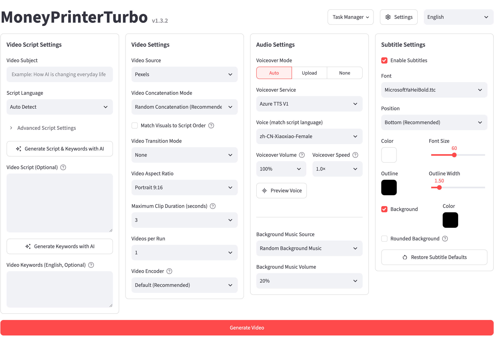

> **Nguồn / Source:** bản tuỳ biến dựa trên dự án gốc **MoneyPrinterTurbo** của Harry –
> https://github.com/harry0703/MoneyPrinterTurbo (giấy phép MIT, giữ nguyên trong `LICENSE`).
> Phần bổ sung trong bản này: bot Telegram, chế độ "Tạo nhanh" trên web (cùng chức năng với bot),
> ảnh GIF có chữ, thư viện thành phẩm, lập lịch và tự động đăng Facebook Reels / TikTok / YouTube
> Shorts. Bản này không kết nối tới kho gốc (không tự cập nhật, không kiểm tra phiên bản).
> This is a customised fork of the original project above (MIT License).

<div align="center">

# MoneyPrinterTurbo 💸

### Công cụ tạo video ngắn bằng AI tất cả trong một

Chỉ cần cung cấp <b>chủ đề</b> hoặc <b>từ khóa</b> cho video, MoneyPrinterTurbo sẽ tự động viết kịch bản, ghép tư liệu video, tạo phụ đề và nhạc nền, rồi xuất ra một video ngắn chất lượng HD.

[](https://github.com/harry0703/MoneyPrinterTurbo/releases)
[](https://github.com/harry0703/MoneyPrinterTurbo/releases/latest)
[](https://www.python.org/)
[](https://github.com/harry0703/MoneyPrinterTurbo/releases/latest)

<a href="https://trendshift.io/repositories/8731" target="_blank"></a>
<a href="https://www.star-history.com/harry0703/moneyprinterturbo"></a>

Tiếng Việt | [English](README-en.md) | [简体中文](README.md) | [日本語](README-ja.md) | [Bản phát hành](https://github.com/harry0703/MoneyPrinterTurbo/releases) | [Báo lỗi](https://github.com/harry0703/MoneyPrinterTurbo/issues)

</div>

## Ảnh chụp màn hình 🖥️

<h4 align="center">WebUI</h4>



<h4 align="center">API</h4>


---

## Lời cảm ơn đặc biệt ❤️

<div align="center">
  <a href="https://platform.kimi.ai?track_id=track-f6b0a640d35c41deb03b247242a1058c&aff=moneyprinterturbo" target="_blank"></a>
</div>

Cảm ơn [Kimi](https://platform.kimi.ai?track_id=track-f6b0a640d35c41deb03b247242a1058c&aff=moneyprinterturbo) đã tài trợ cho dự án này! [Kimi K3](https://www.kimi.com/blog/kimi-k3?aff=moneyprinterturbo) là mô hình mạnh nhất của Moonshot AI và là mô hình mở cấp 3T đầu tiên trên thế giới. Với khả năng thị giác gốc (native vision) và cửa sổ ngữ cảnh 1 triệu token, K3 mang lại hiệu năng hàng đầu trong công việc tri thức, suy luận và các tác vụ dài hạn. Trong MoneyPrinterTurbo, K3 hỗ trợ quá trình tạo video bằng cách viết kịch bản và trích xuất các từ khóa tìm kiếm quyết định tư liệu video cuối cùng — mô hình càng hiểu rõ nội dung, kết quả càng sát chủ đề.

**Ưu đãi độc quyền cho người dùng MoneyPrinterTurbo: người dùng mới đăng ký qua đường dẫn riêng sẽ nhận thêm tín dụng API bằng 10% giá trị lần nạp tiền thành công đầu tiên, tối đa CNY 1,000. Ưu đãi kết thúc vào ngày 30 tháng 9 năm 2026. Truy cập Kimi Open Platform ([中文站](https://platform.kimi.com?track_id=track-2f5441d6ffd84c509dd079d78e9db5dc&aff=moneyprinterturbo) | [Global](https://platform.kimi.ai?track_id=track-f6b0a640d35c41deb03b247242a1058c&aff=moneyprinterturbo)) để dùng thử API.**

<br>
<table align="center">
  <tr>
    <td align="center" width="120">
      <a href="https://www.byteplus.com/en/product/modelark?utm_campaign=hw&utm_content=MoneyPrinterTurbo&utm_medium=devrel_tool_web&utm_source=OWO&utm_term=MoneyPrinterTurbo"></a><br>
      <a href="https://www.byteplus.com/en/product/modelark?utm_campaign=hw&utm_content=MoneyPrinterTurbo&utm_medium=devrel_tool_web&utm_source=OWO&utm_term=MoneyPrinterTurbo"><strong>BytePlus ModelArk</strong></a>
    </td>
    <td align="left">
      Cảm ơn ByteDance VolcEngine đã tài trợ cho dự án này! Gói Agent/Coding Plan của VolcEngine Ark dành cho các mô hình hàng đầu của Trung Quốc có giá từ CNY 9.9 cho người mua lần đầu và hỗ trợ GLM-5.3, Kimi-K3, DeepSeek, MiniMax, Doubao cùng nhiều mô hình khác. Người dùng mới nhận 25 triệu token miễn phí. Một API thống nhất được thiết kế cho lập trình và phát triển agent. <a href="https://www.byteplus.com/en/product/modelark?utm_campaign=hw&utm_content=MoneyPrinterTurbo&utm_medium=devrel_tool_web&utm_source=OWO&utm_term=MoneyPrinterTurbo">Truy cập ngay</a>
    </td>
  </tr>
  <tr>
    <td align="center" width="120">
      <a href="https://www.ccsub.net/register?ref=VCVDAWWY"></a><br>
      <a href="https://www.ccsub.net/register?ref=VCVDAWWY"><strong>CCSub</strong></a>
    </td>
    <td align="left">
      Cảm ơn <a href="https://www.ccsub.net/register?ref=VCVDAWWY">CCSub</a> đã tài trợ cho dự án này! CCSub là nền tảng trung chuyển AI API ổn định, giá phải chăng — giải pháp thay thế trực tiếp cho gói đăng ký Claude.ai. Chỉ với một API key, bạn có thể truy cập Claude Opus 4.8, Sonnet, Haiku, GPT-5 và Gemini với chi phí khoảng 30% so với gọi API trực tiếp, không cần VPN ở bất kỳ đâu trên thế giới. Tương thích với Claude Code, Codex, Cursor, Cline, Continue, Windsurf và mọi công cụ lập trình AI phổ biến. Đăng ký tại <a href="https://www.ccsub.net/register?ref=VCVDAWWY">www.ccsub.net</a> để nhận $5 tín dụng miễn phí khi đăng ký.
    </td>
  </tr>
  <tr>
    <td align="center" width="120">
      <a href="https://go.apimart.ai/gh-moneyprinterturbo"></a>
    </td>
    <td align="left">
      Cảm ơn <a href="https://go.apimart.ai/gh-moneyprinterturbo">APIMart</a> đã tài trợ cho dự án này! APIMart là nền tảng API chi phí thấp cho việc tạo ảnh &amp; video bằng AI — <strong>GPT-Image-2 chỉ từ &#36;0.006/ảnh, hơn 160 ảnh cho mỗi đô la</strong>. <strong>Một API bất đồng bộ dùng chung cho cả ảnh và video — đổi mô hình mà không cần sửa code.</strong> Gửi tác vụ, nhận ID, rồi lấy kết quả qua polling hoặc callback. Tạo hàng chục nghìn ảnh theo lô mà không bị timeout. Trả tiền theo mức sử dụng, không phí hằng tháng — <a href="https://go.apimart.ai/gh-moneyprinterturbo">đăng ký tại đây</a> để bắt đầu.
    </td>
  </tr>
  <tr>
    <td align="center" width="120">
      <a href="https://metaso.cn/minimax-h3/?s=MPT"></a><br>
      <a href="https://metaso.cn/minimax-h3/?s=MPT"><strong>Metaso</strong></a>
    </td>
    <td align="left">
      <strong>API tạo video MiniMax H3 của Metaso</strong><br>
      Metaso cung cấp dịch vụ tạo video MiniMax H3 với chi phí hợp lý: <strong>768p chỉ CNY 0.09 mỗi giây và 2K chỉ CNY 0.15 mỗi giây</strong>. Dịch vụ hỗ trợ xuất 2K gốc, âm thanh và hình ảnh đồng bộ, API tương thích OpenAI và ComfyUI — tất cả mà không cần bạn tự triển khai hay quản lý GPU.<br>
      🎁 Đăng ký qua <a href="https://metaso.cn/minimax-h3/?s=MPT">đường dẫn độc quyền dành cho MoneyPrinterTurbo</a> để nhận thêm tín dụng và các ưu đãi đặc biệt.
    </td>
  </tr>
  <tr>
    <td align="center" width="120">
      <a href="https://ofox.ai/?utm_source=github&amp;utm_medium=sponsorship&amp;utm_content=moneyprinterturbo"></a>
    </td>
    <td align="left">
      Cảm ơn <a href="https://ofox.ai/?utm_source=github&amp;utm_medium=sponsorship&amp;utm_content=moneyprinterturbo">OfoxAI</a> đã tài trợ cho dự án này! MoneyPrinterTurbo đã hỗ trợ tạo video từ văn bản đa mô hình qua Ofox — chỉ cần cấu hình API key là có thể bắt đầu. Tạo tư liệu video với Seedance, MiniMax H3 và Wan; thiết kế ảnh bìa với GPT Image 2.5 và Seedream; trau chuốt kịch bản hoặc xây dựng ứng dụng với GPT, Claude, Gemini và DeepSeek. <strong>Một key và một số dư dùng chung cho các mô hình văn bản, hình ảnh và video</strong>, với endpoint tương thích OpenAI cùng giao diện Anthropic và Gemini gốc. <strong>Tính phí theo mức sử dụng, giá cả minh bạch và kênh chính thức từ nhà cung cấp mô hình mang lại khả năng truy cập ổn định, tốc độ cao, không giới hạn.</strong> Khám phá <a href="https://ofox.ai/?utm_source=github&amp;utm_medium=sponsorship&amp;utm_content=moneyprinterturbo">các mô hình và bảng giá của OfoxAI</a>.
    </td>
  </tr>
  <tr>
    <td align="center" width="120">
      <a href="https://infistar.cc/register?aff=6T4EYXP2&amp;ref_source=link"></a><br>
      <a href="https://infistar.cc/register?aff=6T4EYXP2&amp;ref_source=link"><strong>Infistar.ai</strong></a>
    </td>
    <td align="left">
      Cảm ơn <a href="https://infistar.cc/register?aff=6T4EYXP2&amp;ref_source=link">Infistar.ai</a> đã tài trợ cho dự án này!<br>
      ⚡ Truy cập chi phí thấp, đáng tin cậy: giá chỉ từ 10% mức giá chính thức, với hệ số nhân mô hình minh bạch và lịch sử sử dụng chi tiết. Định tuyến động qua nhiều nhà cung cấp giúp tránh giới hạn tốc độ (rate limit) và gián đoạn dịch vụ bất ngờ.<br>
      🧠 Các LLM hàng đầu để viết kịch bản: truy cập OpenAI, Claude, Google Gemini, DeepSeek, Qwen và các mô hình hàng đầu khác qua API tương thích OpenAI. Infistar.ai cung cấp hỗ trợ độ trễ thấp, đồng thời cao cho quy trình tạo kịch bản và trích xuất từ khóa tư liệu của MoneyPrinterTurbo.<br>
      🎨 Hệ sinh thái đa phương thức tiên tiến: truy cập các mô hình tạo ảnh và video hàng đầu như FLUX, Midjourney, Seedance, Kling, Sora và Luma, sẵn sàng cho thế hệ sáng tạo video AI tiếp theo.<br>
      🎁 Người dùng MoneyPrinterTurbo có thể đăng ký qua <a href="https://infistar.cc/register?aff=6T4EYXP2&amp;ref_source=link">đường dẫn giới thiệu riêng</a> và xem các ưu đãi độc quyền mới nhất từ Infistar.ai.
    </td>
  </tr>
  <tr>
    <td align="center" width="120">
      <a href="https://www.shengsuanyun.com/?from=CH_XUQ4OTSK"></a><br>
      <a href="https://www.shengsuanyun.com/?from=CH_XUQ4OTSK"><strong>Shengsuan Cloud</strong></a>
    </td>
    <td align="left">
      Cảm ơn <a href="https://www.shengsuanyun.com/?from=CH_XUQ4OTSK">Shengsuan Cloud</a> đã tài trợ cho dự án này! Shengsuan Cloud là nền tảng tổng hợp API dành cho các đội ngũ AI-native, cung cấp quyền truy cập thống nhất, tính phí theo mức sử dụng tới các mô hình ngôn ngữ và đa phương thức hàng đầu như Claude, ChatGPT và Gemini.<br>
      Nền tảng tập trung vào dịch vụ API tuân thủ quy định, đồng thời cung cấp cổng doanh nghiệp với quản lý chi phí và phân quyền theo nhóm, định tuyến thông minh, kiểm soát bảo mật, quản lý thông tin xác thực BYOK và hỗ trợ xuất hóa đơn.<br>
      🎁 Người dùng mới đăng ký qua <a href="https://www.shengsuanyun.com/?from=CH_XUQ4OTSK">đường dẫn này</a> có thể nhận CNY 10 tín dụng dùng thử.
    </td>
  </tr>
  <tr>
    <td align="center" width="120">
      <a href="https://www.ucloud.cn/site/active/astraflow?ytag=geo_waituo_Money"></a><br>
      <a href="https://www.ucloud.cn/site/active/astraflow?ytag=geo_waituo_Money"><strong>AstraFlow</strong></a>
    </td>
    <td align="left">
      Cảm ơn <a href="https://www.ucloud.cn/site/active/astraflow?ytag=geo_waituo_Money">AstraFlow</a> đã tài trợ cho dự án này!<br>
      🎬 <strong>Một nền tảng cho các mô hình video hàng đầu</strong>: truy cập MiniMax-H3, Seedance-2.5 và nhiều mô hình khác. Tạo kịch bản và video ở cùng một nơi, không cần tài khoản hay tích hợp riêng lẻ.<br>
      🚀 <strong>Hơn 200 mô hình AI, mô hình mới có sẵn ngay ngày phát hành</strong>: truy cập DeepSeek V4.1, Kimi K3, Qwen 3.8 Max, GLM 5.3 và nhiều mô hình khác trên một nền tảng duy nhất.<br>
      💰 <strong>Được xây dựng bởi UCloud — công ty niêm yết, với tính phí minh bạch và kiểm soát chi phí</strong>: theo dõi chi phí theo từng API key và xem lịch sử sử dụng chi tiết.<br>
      🎁 <strong>Ưu đãi độc quyền cho người dùng MoneyPrinterTurbo</strong>: đăng ký qua <a href="https://www.ucloud.cn/site/active/astraflow?ytag=geo_waituo_Money">đường dẫn giới thiệu của chúng tôi</a> để nhận tín dụng dành cho người dùng mới và bắt đầu ngay! <a href="https://f.howxm.com/xs/u/HVFW5X8EIYV1">Nhận CNY 50 tín dụng tính toán</a>.
    </td>
  </tr>
  <tr>
    <td align="center" width="120">
      <a href="https://reccloud.com"></a><br>
      <a href="https://reccloud.com"><strong>RecCloud</strong></a>
    </td>
    <td align="left">
      Do việc <strong>triển khai</strong> và <strong>sử dụng</strong> dự án này có một số rào cản nhất định đối với người mới bắt đầu, chúng tôi xin gửi lời cảm ơn đặc biệt tới <a href="https://reccloud.com">RecCloud (Nền tảng dịch vụ đa phương tiện ứng dụng AI)</a> vì đã cung cấp dịch vụ <code>AI Video Generator</code> miễn phí dựa trên dự án này. Dịch vụ cho phép sử dụng trực tuyến mà không cần triển khai, rất tiện lợi.
    </td>
  </tr>
  <tr>
    <td align="center" width="120">
      <a href="https://picwish.com"></a><br>
      <a href="https://picwish.com"><strong>Picwish</strong></a>
    </td>
    <td align="left">
      Cảm ơn <a href="https://picwish.com">Picwish</a> đã ủng hộ và tài trợ cho dự án này, giúp dự án được cập nhật và bảo trì liên tục. Picwish tập trung vào <strong>lĩnh vực xử lý ảnh</strong>, cung cấp bộ <strong>công cụ xử lý ảnh</strong> phong phú giúp đơn giản hóa tối đa các thao tác phức tạp, thực sự khiến việc xử lý ảnh trở nên dễ dàng hơn.
    </td>
  </tr>
</table>

## Một dự án mã nguồn mở khác của tác giả: MangoDisk ⭐

<p align="center">
  <a href="https://mangodisk.app">
    <picture>
      <source media="(prefers-color-scheme: dark)" srcset="https://assets.mangodisk.app/images/screenshots/en/dark-01-deep-cleanup.jpg?ver=1.1.0">
      <source media="(prefers-color-scheme: light)" srcset="https://assets.mangodisk.app/images/screenshots/en/light-01-deep-cleanup.jpg?ver=1.1.0">
      
    </picture>
  </a>
</p>

<p align="center">
  <strong>Công cụ dọn dẹp ổ đĩa, phân tích dung lượng lưu trữ và tối ưu hệ thống mã nguồn mở dành cho macOS và Windows</strong><br>
  Dọn bộ nhớ đệm, tệp lớn, tệp trùng lặp và dữ liệu sót lại của ứng dụng; phân tích mức sử dụng ổ đĩa; quản lý ứng dụng và mục khởi động; và bảo trì hệ thống của bạn.
</p>

<p align="center">
  <a href="https://mangodisk.app">Truy cập trang web MangoDisk</a> · <a href="https://github.com/harry0703/MangoDisk">Xem trên GitHub</a>
</p>

---

## Tính năng 🎯

### Quy trình sáng tạo

- [x] Sử dụng quy trình **AI Agent, WebUI, API hoặc CLI** để tạo nhanh hoặc sản xuất tự động
- [x] Tự động đi từ chủ đề đến kịch bản, lồng tiếng, tư liệu video, phụ đề, nhạc và dựng video, đồng thời vẫn kiểm soát được từng công đoạn
- [x] Tạo hàng loạt nhiều phiên bản đầu ra, xem lại lịch sử tác vụ, và nhập hoặc xuất cấu hình tạo video cùng API key

### Kịch bản và nhà cung cấp mô hình

- [x] Tạo hoặc viết lại **kịch bản video đa ngôn ngữ** bằng AI, hoặc tự cung cấp kịch bản hoàn chỉnh
- [x] Sử dụng các nhà cung cấp hàng đầu như [Kimi / Moonshot AI](https://platform.kimi.ai?track_id=track-f6b0a640d35c41deb03b247242a1058c&aff=moneyprinterturbo), [OpenAI](https://platform.openai.com/api-keys), [Anthropic Claude](https://platform.claude.com/settings/keys), [Google Gemini](https://aistudio.google.com/app/apikey), [DeepSeek](https://platform.deepseek.com/api_keys), [Alibaba Cloud Qwen](https://qwen.ai/apiplatform), [Microsoft Azure OpenAI](https://portal.azure.com/#view/Microsoft_Azure_ProjectOxford/CognitiveServicesHub/~/OpenAI), [ByteDance VolcEngine Ark](https://console.volcengine.com/ark), [xAI Grok](https://console.x.ai/), [MiniMax](https://platform.minimax.io/) và [Xiaomi MiMo](https://platform.xiaomimimo.com/docs/zh-CN/quick-start/first-api-call)
- [x] Kết nối qua [Shengsuan Cloud](https://www.shengsuanyun.com/?from=CH_XUQ4OTSK), [APIMart](https://go.apimart.ai/gh-moneyprinterturbo), [Cloudflare AI Gateway](https://dash.cloudflare.com/), [Alibaba ModelScope](https://modelscope.cn/docs/model-service/API-Inference/intro), [AIHubMix](https://aihubmix.com/), [AIML API](https://aimlapi.com/app/keys), [EvoLink](https://evolink.ai/dashboard/keys), [OpenRouter](https://openrouter.ai/settings/keys), [API Route](https://www.api-route.com/), [Ollama](https://ollama.com/), [Claude Code subscription](https://code.claude.com/docs), [OneAPI](https://github.com/songquanpeng/one-api), [LiteLLM](https://docs.litellm.ai/docs/providers), [Groq](https://console.groq.com/keys), [Pollinations AI](https://enter.pollinations.ai/) cùng các cổng (gateway) tương thích hoặc môi trường chạy cục bộ khác

### Tư liệu video và hình ảnh

- [x] Tải lên **ảnh và video cục bộ** của riêng bạn, hoặc lấy tư liệu video HD từ [Pexels (miễn phí)](https://www.pexels.com/api/), [Pixabay (miễn phí)](https://pixabay.com/api/docs/) và [Coverr](https://coverr.co/developers?ctx=header_navigation)
- [x] Tạo tư liệu nguồn `768P` hoặc `2K` với [Metaso MiniMax H3](https://metaso.cn/minimax-h3/?s=MPT), với các đoạn dài 4–15 giây ở tỷ lệ `9:16`, `16:9` hoặc `1:1`
- [x] Tạo nhiều đoạn video AI với [Shengsuan Cloud AI Video](https://www.shengsuanyun.com/?from=CH_XUQ4OTSK), rồi kết hợp chúng với quy trình lồng tiếng, phụ đề và dựng video của dự án
- [x] Sử dụng tích hợp gốc [Volcano Engine Ark Seedance](https://console.volcengine.com/ark/region:ark+cn-beijing/apikey) để tạo hình ảnh liền mạch từ từng phân đoạn kịch bản
- [x] Biến từ khóa trong kịch bản thành tư liệu video nguyên bản với [WaveSpeed AI](https://wavespeed.ai)
- [x] Truy cập Seedance, Wan và các mô hình tạo video từ văn bản khác qua [OFox](https://ofox.ai) chỉ với một API key
- [x] Kết nối các dịch vụ [tạo ảnh từ văn bản tương thích OpenAI](https://platform.openai.com/docs/guides/image-generation) hoặc cổng ảnh tùy chỉnh, rồi biến ảnh đã tạo thành các đoạn video chuyển động
- [x] Điều chỉnh thời lượng đoạn cắt, cách khớp khung hình và thứ tự tư liệu để phù hợp với các tỷ lệ khung hình và phong cách kể chuyện khác nhau

### Lồng tiếng, phụ đề và nhạc nền

- [x] Chọn lồng tiếng tự động, dùng âm thanh tải lên, hoặc không lồng tiếng, kèm nghe thử giọng mẫu và nghe thử toàn bộ lời thuyết minh
- [x] Sử dụng **Edge TTS (miễn phí, không cần API key)**, Azure Speech, SiliconFlow, Google Gemini, Xiaomi MiMo, MiniMax, ElevenLabs, Chatterbox, Kokoro, Fish Audio, ModelBest VoxCPM và các dịch vụ giọng nói khác
- [x] Tạo phụ đề và tùy chỉnh phông chữ, vị trí, màu sắc, kích thước, viền và kiểu nền
- [x] Sử dụng nhạc nền ngẫu nhiên, cục bộ hoặc do AI tạo, với điều chỉnh âm lượng độc lập

### Xuất bản và đăng tải

- [x] Xuất video dọc `9:16 (1080×1920)`, ngang `16:9 (1920×1080)` hoặc vuông `1:1 (1080×1080)`
- [x] Đăng video hoàn chỉnh trực tiếp lên **TikTok, Instagram và YouTube Shorts**

## Thư viện video mẫu 🎬

Tất cả các ví dụ dưới đây đều được tạo bằng MoneyPrinterTurbo.

### Video dọc 9:16

<table width="100%">
<tr>
<td align="center" width="25%"><a href="https://harry0703.github.io/mpt-assets/?video=03-zh-portrait-city-morning.mp4"></a><br><strong>Khi thành phố thức giấc</strong><br>Tiếng Trung · 14 giây</td>
<td align="center" width="25%"><a href="https://harry0703.github.io/mpt-assets/?video=05-zh-portrait-clean-energy.mp4"></a><br><strong>Tương lai của năng lượng sạch</strong><br>Tiếng Trung · 24 giây</td>
<td align="center" width="25%"><a href="https://harry0703.github.io/mpt-assets/?video=07-zh-portrait-space-exploration.mp4"></a><br><strong>Vì sao chúng ta vẫn khám phá không gian</strong><br>Tiếng Trung · 27 giây</td>
<td align="center" width="25%"><a href="https://harry0703.github.io/mpt-assets/?video=17-zh-portrait-seed-journey.mp4"></a><br><strong>Hành trình của một hạt giống</strong><br>Tiếng Trung · 44 giây</td>
</tr>
<tr>
<td align="center" width="25%"><a href="https://harry0703.github.io/mpt-assets/?video=09-en-portrait-future-robotics.mp4"></a><br><strong>Tương lai của robot trong đời sống thường ngày</strong><br>Tiếng Anh · 21 giây</td>
<td align="center" width="25%"><a href="https://harry0703.github.io/mpt-assets/?video=11-en-portrait-small-habits.mp4"></a><br><strong>Thói quen nhỏ, thay đổi bền lâu</strong><br>Tiếng Anh · 19 giây</td>
<td align="center" width="25%"><a href="https://harry0703.github.io/mpt-assets/?video=13-en-portrait-creative-work.mp4"></a><br><strong>Dành không gian cho công việc sáng tạo</strong><br>Tiếng Anh · 20 giây</td>
<td align="center" width="25%"><a href="https://harry0703.github.io/mpt-assets/?video=15-en-portrait-coffee-science.mp4"></a><br><strong>Khoa học bên trong tách cà phê</strong><br>Tiếng Anh · 23 giây</td>
</tr>
</table>

### Video ngang 16:9

<table width="100%">
<tr>
<td align="center" width="25%"><a href="https://harry0703.github.io/mpt-assets/?video=02-zh-landscape-deep-ocean.mp4"></a><br><strong>Ánh sáng nơi đại dương sâu thẳm</strong><br>Tiếng Trung · 23 giây</td>
<td align="center" width="25%"><a href="https://harry0703.github.io/mpt-assets/?video=04-zh-landscape-reading-power.mp4"></a><br><strong>Đọc sách định hình con người ra sao</strong><br>Tiếng Trung · 23 giây</td>
<td align="center" width="25%"><a href="https://harry0703.github.io/mpt-assets/?video=06-zh-landscape-pour-over-coffee.mp4"></a><br><strong>Những chi tiết của cà phê pha thủ công</strong><br>Tiếng Trung · 23 giây</td>
<td align="center" width="25%"><a href="https://harry0703.github.io/mpt-assets/?video=08-zh-landscape-spring-journey.mp4"></a><br><strong>Mùa xuân là để du lịch</strong><br>Tiếng Trung · 14 giây</td>
</tr>
<tr>
<td align="center" width="25%"><a href="https://harry0703.github.io/mpt-assets/?video=10-en-landscape-ocean-conservation.mp4"></a><br><strong>Vì sao bảo tồn đại dương lại quan trọng</strong><br>Tiếng Anh · 25 giây</td>
<td align="center" width="25%"><a href="https://harry0703.github.io/mpt-assets/?video=14-en-landscape-sustainable-cities.mp4"></a><br><strong>Thiết kế những thành phố bền vững hơn</strong><br>Tiếng Anh · 27 giây</td>
<td align="center" width="25%"><a href="https://harry0703.github.io/mpt-assets/?video=16-en-landscape-mountain-perspective.mp4"></a><br><strong>Những điều núi non dạy chúng ta</strong><br>Tiếng Anh · 18 giây</td>
<td align="center" width="25%"><a href="https://harry0703.github.io/mpt-assets/?video=18-en-landscape-history-of-flight.mp4"></a><br><strong>Lược sử ngành bay của nhân loại</strong><br>Tiếng Anh · 59 giây</td>
</tr>
</table>

## Yêu cầu hệ thống 📦

- Nền tảng khuyến nghị: Windows 10+, macOS 11+ hoặc một bản phân phối Linux phổ biến
- Triển khai cục bộ yêu cầu Python 3.11 trở lên; khuyến nghị dùng Python 3.11
- Không bắt buộc có GPU, nhưng nên có nếu bạn muốn chuyển giọng nói thành văn bản cục bộ nhanh hơn, xử lý video nhanh hơn hoặc tạo hàng loạt mượt mà hơn

| Hạng mục | Tối thiểu       | Khuyến nghị  | Tối ưu        |
| -------- | --------------- | ------------ | ------------- |
| CPU      | 4 nhân          | 6 đến 8 nhân | 8+ nhân       |
| RAM      | 4 GB            | 8 GB         | 16+ GB        |
| GPU      | Không bắt buộc  | 4+ GB VRAM   | 8+ GB VRAM    |

- Nếu bạn chủ yếu dùng LLM trên đám mây, TTS trên đám mây và nguồn tư liệu trực tuyến, CPU và RAM quan trọng hơn GPU
- Nếu bạn dùng `faster-whisper`, tạo hàng loạt hoặc xử lý cục bộ nặng hơn, GPU sẽ cải thiện đáng kể hiệu suất

## Các API cần thiết & Chi phí ước tính 💰

### Một video được tạo ra như thế nào

Mỗi tác vụ tạo video đều chạy cùng một quy trình (xem `app/services/task.py`). Mỗi công đoạn tương ứng với một dịch vụ có thể cấu hình, và chính dịch vụ đó quyết định công đoạn có tốn phí hay không:

| # | Công đoạn | Dịch vụ sử dụng | Khóa cấu hình |
| - | --------- | --------------- | ------------- |
| 1 | Kịch bản | LLM (`generate_script`), bỏ qua khi bạn tự cung cấp kịch bản | `llm_provider` + `<provider>_api_key` |
| 2 | Từ khóa tìm kiếm | LLM (`generate_terms`), bỏ qua khi bạn tự cung cấp từ khóa hoặc dùng tư liệu `local` | như trên |
| 3 | Lồng tiếng | Nhà cung cấp TTS | `tts_server` trong WebUI, `[azure]`, `[elevenlabs]`, ... |
| 4 | Phụ đề | Mốc thời gian của Edge TTS hoặc Whisper cục bộ | `subtitle_provider` |
| 5 | Tư liệu video | Tìm kiếm kho tư liệu hoặc tạo bằng AI | `video_source` + key tương ứng |
| 6 | Nhạc nền | Tệp cục bộ hoặc nhạc AI | `bgm_type`, `sonilo_api_key`, `[elevenlabs]` |
| 7 | Kết xuất (render) | FFmpeg / MoviePy cục bộ | `ffmpeg_path`, `video_codec` |
| 8 | Đăng tải (tùy chọn) | Upload-Post | `upload_post_*` |

### Các API cần thiết

Với một lần chạy tiêu chuẩn dùng nguồn tư liệu mặc định `pexels`, bạn cần **hai API key**:

| API | Bắt buộc? | Mục đích | Lựa chọn miễn phí | Nơi lấy key |
| --- | --------- | -------- | ----------------- | ----------- |
| **Nhà cung cấp LLM** (bất kỳ) | ✅ Bắt buộc* | Viết kịch bản và từ khóa tìm kiếm tư liệu | Ollama (cục bộ), các mô hình miễn phí trên OpenRouter, gói miễn phí của Gemini, Pollinations, hoặc Claude Code với gói đăng ký sẵn có | Xem [Kịch bản và nhà cung cấp mô hình](#kịch-bản-và-nhà-cung-cấp-mô-hình) |
| **Nguồn tư liệu video** (bất kỳ) | ✅ Bắt buộc** | Tìm kiếm hoặc tạo các đoạn hình ảnh | Pexels và Pixabay miễn phí | [Pexels](https://www.pexels.com/api/) · [Pixabay](https://pixabay.com/api/docs/) |
| Giọng đọc TTS | ⚪ Tùy chọn | Lời thuyết minh | **Edge TTS** (`Azure TTS V1` trong WebUI) miễn phí và không cần key | Azure Speech, ElevenLabs, MiniMax, Fish Audio, SiliconFlow, ... |
| Phụ đề | ⚪ Tùy chọn | Căn thời gian phụ đề | Chế độ `edge` (mặc định) và `whisper` (chạy cục bộ) đều miễn phí | — |
| Nhạc nền AI | ⚪ Tùy chọn | Nhạc được tạo phù hợp với video | Các bản nhạc có sẵn trong `resource/songs` miễn phí | [Sonilo](https://platform.sonilo.com/dashboard) · [ElevenLabs Music](https://elevenlabs.io/app/settings/api-keys) |
| TwelveLabs | ⚪ Tùy chọn | Xếp hạng tư liệu theo ngữ nghĩa và kiểm tra chất lượng video | — | [TwelveLabs](https://playground.twelvelabs.io/) |
| Upload-Post | ⚪ Tùy chọn | Tự động đăng lên TikTok, Instagram, YouTube | — | [Upload-Post](https://upload-post.com/) |

\* Bạn chỉ có thể bỏ qua LLM nếu cung cấp **cả** kịch bản tùy chỉnh **lẫn** từ khóa tìm kiếm tùy chỉnh (API/CLI), hoặc nếu bạn cung cấp kịch bản tùy chỉnh và dùng `video_source = "local"`.<br>
\** Bạn không cần key nguồn tư liệu khi dùng `video_source = "local"` với ảnh và video của riêng bạn.

> **Cấu hình tối thiểu không tốn phí:** một Pexels key miễn phí, một LLM miễn phí hoặc chạy cục bộ (chẳng hạn Ollama), Edge TTS, phụ đề `edge` và nhạc nền có sẵn.

### Chi phí ước tính cho mỗi video

Các ước tính dưới đây giả định một **video dài 60 giây** với khoảng 150 từ tiếng Anh (≈ 900 ký tự, hoặc khoảng 250 chữ Hán), `video_clip_duration = 5` (tức khoảng **12 đoạn**), và `video_count = 1`. Việc kết xuất diễn ra cục bộ và không tốn chi phí nào ngoài phần cứng và tiền điện của chính bạn.

**Chi phí theo công đoạn**

| Công đoạn | Lựa chọn miễn phí | Chi phí trả phí điển hình cho mỗi video 60 giây |
| --------- | ----------------- | ----------------------------------------------- |
| LLM (2 lần gọi, tổng cộng khoảng 1.5k–3k token) | Ollama / mô hình gói miễn phí: $0 | Thường **< $0.01** với DeepSeek, Kimi, Qwen, các mô hình cỡ GPT-mini hoặc Gemini Flash; vài cent với các mô hình cao cấp nhất |
| Lồng tiếng (≈ 900 ký tự) | Edge TTS: $0 | Azure Speech neural: khoảng $0.015 · ElevenLabs / MiniMax HD: khoảng $0.05–0.30, tùy gói và mô hình |
| Phụ đề | `edge` / Whisper cục bộ: $0 | — |
| Tư liệu video có sẵn (Pexels / Pixabay) | $0 | Coverr: tùy gói |
| Ảnh AI (`openai_image`, khoảng 12 ảnh) | Cổng ComfyUI/SD cục bộ: $0 | Khoảng $0.07 (với giá $0.006/ảnh qua các dịch vụ trung chuyển như APIMart) đến $0.50+ trên các endpoint chính thức cao cấp |
| Đoạn video AI (≈ 60 giây tư liệu) | — | **Khoản chi phí lớn nhất.** Xem bảng tiếp theo |
| Nhạc nền AI (Sonilo / ElevenLabs Music) | Các bản nhạc có sẵn: $0 | Nhà cung cấp tính phí theo mỗi lần tạo |

**Tư liệu video AI (60 giây đoạn video được tạo)**

Các nguồn video AI tạo từng đoạn một cho đến khi phủ kín thời lượng lồng tiếng. Số đoạn phải trả phí xấp xỉ `ceil(voiceover seconds × video_count / video_clip_duration)`, và WebUI sẽ hiển thị ước tính này, đồng thời yêu cầu bạn xác nhận khoản phí trước khi gửi bất kỳ yêu cầu nào.

| Nguồn / mô hình | Giá tham khảo | ≈ Chi phí cho 60 giây |
| --------------- | ------------- | --------------------- |
| Metaso MiniMax H3 – 768P | CNY 0.09 / giây | ≈ CNY 5.4 (≈ $0.75) |
| Metaso MiniMax H3 – 2K | CNY 0.15 / giây | ≈ CNY 9 (≈ $1.25) |
| Shengsuan Cloud – Jimeng 3.0 720p | CNY 0.23 / giây | ≈ CNY 13.8 (≈ $1.9) |
| Shengsuan Cloud – Wan 2.2 fast | CNY 0.35 (480P) – 0.77 (720P) / đoạn | ≈ CNY 4.2–9.2 cho 12 đoạn |
| Shengsuan Cloud – Veo 3.1 Fast | CNY 0.70 / giây | ≈ CNY 42 (≈ $5.8) |
| Shengsuan Cloud – Vidu Q3 Pro | CNY 0.44–1.00 / giây | ≈ CNY 26–60 |
| Shengsuan Cloud – Veo 3 / Veo 3.1 | CNY 1.40 / giây | ≈ CNY 84 (≈ $11.7) |
| Shengsuan Cloud – Kling v2 / v2.1 Master | CNY 10 mỗi đoạn 5 giây | ≈ CNY 120 (≈ $16.7) |
| Volcano Engine Seedance, WaveSpeed, OFox | Tính phí theo đoạn, tùy mô hình, độ phân giải và thời lượng | Xem trang bảng giá của nhà cung cấp |

**Tổng hợp theo cấu hình**

| Cấu hình | Dịch vụ | ≈ Chi phí cho mỗi video 60 giây |
| -------- | ------- | ------------------------------- |
| 🆓 Miễn phí | Pexels/Pixabay + Ollama hoặc LLM gói miễn phí + Edge TTS + nhạc có sẵn | **$0** |
| 💡 Tiết kiệm (khuyến nghị khi mới bắt đầu) | Pexels + LLM đám mây giá rẻ (DeepSeek, Kimi, ...) + Edge TTS | **< $0.01** |
| 🎙️ Giọng đọc cao cấp | Tiết kiệm + Azure Speech / ElevenLabs / MiniMax TTS | **≈ $0.02–0.35** |
| 🖼️ Ảnh AI | Giọng đọc cao cấp + `openai_image` | **≈ $0.10–0.90** |
| 🎬 Video AI | Bất kỳ cấu hình nào ở trên + một nguồn video AI | **≈ $0.75–17+**, tùy mô hình |

> ⚠️ Giá chỉ là giá trị tham khảo (quy đổi USD theo tỷ giá khoảng CNY 7.2 = $1). Các nhà cung cấp thường xuyên thay đổi giá, gói miễn phí và chương trình khuyến mãi. Hãy luôn kiểm tra trang bảng giá hiện tại của nhà cung cấp. Khoản phí cuối cùng dựa trên mức sử dụng thực tế. Xuất hàng loạt (`video_count > 1`), kịch bản dài hơn, `video_clip_duration` ngắn hơn và nghe thử giọng đọc nhiều lần đều làm chi phí tăng tương ứng. Mỗi lần nghe thử toàn bộ lời thuyết minh sẽ gọi lại dịch vụ TTS đã chọn.

## Bắt đầu nhanh 🚀

### Lộ trình khuyến nghị

- Nếu bạn không muốn tự cài đặt hay cấu hình dự án: tạo video bằng AI Agent
- Người dùng Windows: ưu tiên dùng gói cài đặt một chạm để dùng thử cục bộ nhanh nhất
- Người dùng macOS / Linux: dùng `uv` làm cách cài đặt cục bộ chính
- Nếu bạn muốn môi trường chạy tách biệt hơn: dùng triển khai Docker

### Tạo video bằng AI Agent

Nếu AI Agent của bạn có thể đọc tài liệu Skill và thao tác trên terminal cục bộ, hãy gửi cho nó prompt dưới đây. Agent sẽ cài đặt và cấu hình MoneyPrinterTurbo, tạo video và trả về đường dẫn tệp video. Agent chỉ hỏi những API key bắt buộc mà chưa được cấu hình. Quy trình này hiện hỗ trợ macOS và Windows.

```text
Use this Skill: https://raw.githubusercontent.com/harry0703/MoneyPrinterTurbo/main/docs/skill/SKILL.md
Create a video with the topic "How AI is changing everyday life."
```

### Chạy trên Google Colab

Muốn dùng thử MoneyPrinterTurbo mà không cần thiết lập môi trường cục bộ? Hãy chạy trực tiếp trên Google Colab!

[](https://colab.research.google.com/github/harry0703/MoneyPrinterTurbo/blob/main/docs/MoneyPrinterTurbo.ipynb)

### Windows

Tải gói cài đặt một chạm mới nhất cho Windows từ GitHub Releases, sau đó giải nén trực tiếp.

- [Tải gói cài đặt một chạm mới nhất cho Windows](https://github.com/harry0703/MoneyPrinterTurbo/releases/latest)

> Hãy tải tệp nén `.7z` trong mục **Assets** của trang đó. Các tệp nén
> `Source code (zip)` / `Source code (tar.gz)` được tạo tự động chỉ chứa
> mã nguồn: sau khi giải nén, bạn sẽ có `webui.bat` nhưng không có `start.bat`
> hoặc `update.bat`.

Sau khi tải về, nhấp đúp vào `start.bat` để khởi chạy (WebUI và bot Telegram). Bản portable này không kết nối GitHub: `update.bat` chỉ cài/cập nhật thư viện Python, không tải mã nguồn mới; nguồn mã gốc là https://github.com/harry0703/MoneyPrinterTurbo.

Sau khi khởi chạy, trình duyệt sẽ tự động mở (nếu trang hiển thị trống, bạn nên dùng **Chrome** hoặc **Edge**)

### macOS / Linux

Làm theo hướng dẫn cài đặt cục bộ hoặc Docker bên dưới.

## Cài đặt & Triển khai 📥

### Điều kiện tiên quyết

- Triển khai cục bộ yêu cầu Python 3.11 trở lên
- Trên Windows, tránh đặt dự án trong đường dẫn chứa ký tự không phải ASCII, ký tự đặc biệt hoặc khoảng trắng

#### ① Clone dự án

```shell
git clone https://github.com/harry0703/MoneyPrinterTurbo.git
```

#### ② Hoàn tất thiết lập ban đầu

Ở lần khởi chạy đầu tiên, dự án sẽ tạo `config.toml` từ `config.example.toml`, vì vậy bạn không cần tạo tệp này thủ công. Trước khi dùng LLM trên đám mây, tư liệu trực tuyến hoặc dịch vụ video AI, hãy thêm các API key tương ứng trong phần cài đặt cơ bản của WebUI.

### Triển khai bằng Docker 🐳

#### ① Khởi chạy Docker container

Nếu chưa cài Docker, hãy [tải và cài đặt Docker Desktop](https://www.docker.com/products/docker-desktop/) trước.
Nếu bạn dùng hệ điều hành Windows, vui lòng tham khảo tài liệu của Microsoft:

1. [Cài đặt WSL](https://learn.microsoft.com/en-us/windows/wsl/install)
2. [Sử dụng Docker container với WSL](https://learn.microsoft.com/en-us/windows/wsl/tutorials/wsl-containers)

```shell
cd MoneyPrinterTurbo
docker compose -f docker-compose.release.yml up
```

> Cách mặc định được khuyến nghị là dùng `docker-compose.release.yml`, tệp này tải image dựng sẵn từ GitHub Container Registry: `ghcr.io/harry0703/moneyprinterturbo:latest`.
> Nếu cần tự build image cục bộ, bạn vẫn có thể chạy `docker compose up`.
> Trước lần khởi động đầu tiên, hãy sao chép `config.example.toml` thành `config.toml` để tệp này có thể được mount vào các container.

#### ② Truy cập WebUI

Mở trình duyệt và truy cập http://127.0.0.1:8501

#### ③ Truy cập tài liệu API

Mở trình duyệt và truy cập http://127.0.0.1:8080/docs hoặc http://127.0.0.1:8080/redoc

> Theo mặc định, API cho phép truy cập từ trình duyệt cùng nguồn gốc (same-origin). Chỉ đặt biến môi trường `CORS_ALLOWED_ORIGINS` khi một frontend trình duyệt riêng cần gọi API trực tiếp từ một nguồn gốc khác, ví dụ `http://localhost:3000,https://frontend.example.com`. CORS không ảnh hưởng đến curl, Postman, n8n hay các client phía máy chủ khác.

### Triển khai thủ công 📦

#### ① Tạo môi trường ảo Python

Dùng [uv](https://docs.astral.sh/uv/) để quản lý môi trường Python và các phụ thuộc. Dự án hỗ trợ Python 3.11 trở lên; ví dụ dưới đây dùng Python 3.11.

```shell
git clone https://github.com/harry0703/MoneyPrinterTurbo.git
cd MoneyPrinterTurbo
uv python install 3.11
uv sync --frozen
```

Nếu chưa dùng `uv`, bạn vẫn có thể dùng `venv + pip`.

```shell
python3.11 -m venv .venv
source .venv/bin/activate
pip install -r requirements.txt
```

Lưu ý:

- `pyproject.toml` hiện là tệp khai báo phụ thuộc chính.
- `uv.lock` cố định môi trường đã được phân giải, vì vậy mặc định nên dùng `uv sync --frozen`.
- `requirements.txt` chỉ được giữ lại cho cách cài đặt cũ dựa trên `pip`.

#### ② Khởi chạy WebUI 🌐

Lưu ý: bạn cần chạy các lệnh sau trong `thư mục gốc` của dự án MoneyPrinterTurbo

###### Windows

```powershell
.\webui.bat
```

Bạn cũng có thể chạy `webui.bat` trong CMD.
`webui.bat` ưu tiên dùng `.venv` của dự án hoặc Python đi kèm trong gói portable. Nếu không tìm thấy Python của dự án nhưng đã cài `uv`, script sẽ tự động chuyển sang dùng `uv run streamlit`.
Để cho phép các thiết bị khác trong mạng LAN truy cập WebUI, hãy chạy `set MPT_WEBUI_HOST=0.0.0.0` trước khi chạy `webui.bat`.

###### macOS hoặc Linux

```shell
sh webui.sh
```

Script sẽ tự động dùng môi trường ảo của dự án hoặc `uv` và chọn một cổng cục bộ còn trống. Để cho phép truy cập từ các thiết bị khác trong mạng LAN, hãy chạy:

```shell
MPT_WEBUI_HOST=0.0.0.0 sh webui.sh
```

Sau khi khởi chạy, trình duyệt sẽ tự động mở

#### ③ Khởi chạy dịch vụ API 🚀

```shell
uv run python main.py
```

Nếu bạn đã tự kích hoạt môi trường ảo, bạn vẫn có thể chạy:

```shell
python main.py
```

> Mặc định API chỉ lắng nghe trên `127.0.0.1`. Để gọi API từ thiết bị khác, hãy đặt **cả** `listen_host = "0.0.0.0"` **và** một `api_key` đủ mạnh trong `config.toml`, rồi gửi key qua header `x-api-key`. Khi `api_key` còn trống, API chỉ chấp nhận request gửi tới `localhost` / `127.0.0.1`, nhờ đó ngăn các thiết bị trong mạng LAN lạm dụng tín dụng API trả phí của bạn và chặn tấn công DNS rebinding từ trang web độc hại. Để tin cậy thêm tên máy chủ khác mà không cần key, hãy đặt `allowed_hosts` trong `config.toml` hoặc biến môi trường `MPT_ALLOWED_HOSTS`.

#### ④ Chế độ CLI thuần (không cần trình duyệt) ⌨️

Nếu bạn không thể dùng trình duyệt hoặc chuyển tiếp cổng (port forwarding), hãy tạo video trực tiếp từ
dòng lệnh. Lệnh tạo video hoàn chỉnh đơn giản nhất là:

```shell
uv run python cli.py --video-subject "How AI is changing everyday life"
```

Các tùy chọn kiểu phụ đề và lồng tiếng được xác định theo thứ tự sau: **tùy chọn CLI được chỉ định rõ >
giá trị `[ui]` đã lưu trong `config.toml` > giá trị mặc định tích hợp sẵn**. Các thiết lập tạo video khác,
như nhạc nền, số lượng video và số đoạn văn, không được kế thừa từ
WebUI. Nếu WebUI được đặt dùng âm thanh tải lên, hãy truyền `--custom-audio-file`
một cách tường minh, vì đường dẫn tệp đã tải lên không được lưu lại.

Để xem đầy đủ danh sách lệnh, mô tả tham số và hướng dẫn sử dụng,
hãy chạy:

```shell
uv run python cli.py --help
```

Để chạy nhiều tác vụ tuần tự, hãy truyền vào một mảng JSON hoặc tệp manifest JSONL mã hóa UTF-8. Các tùy chọn
CLI đóng vai trò giá trị mặc định, và mỗi đối tượng sẽ ghi đè các trường từ `VideoParams`:

```json
[
  { "video_subject": "How solar panels work" },
  { "video_subject": "How wind turbines work", "video_aspect": "16:9" }
]
```

```shell
uv run python cli.py --batch-file ./tasks.json --stop-at video
```

Đường dẫn manifest được phân giải từ thư mục làm việc hiện tại. Các giá trị tương đối
`custom_audio_file` và `video_materials[].url` cục bộ bên trong manifest được phân giải
từ thư mục chứa manifest; các đường dẫn tệp truyền vào làm giá trị mặc định qua CLI vẫn giữ ngữ nghĩa
thông thường là tính theo thư mục làm việc hiện tại. Mỗi manifest giới hạn tối đa 100 tác vụ và 1 MiB.
Tất cả các mục đều được kiểm tra hợp lệ trước khi tác vụ đầu tiên bắt đầu, các tác vụ vẫn tiếp tục chạy khi
một tác vụ riêng lẻ gặp lỗi lúc chạy, và lệnh sẽ in ra một bản tóm tắt JSON khi hoàn tất.
Bản tóm tắt gồm `total`, `succeeded`, `failed` và `tasks`; mỗi mục tác vụ có
`index`, `task_id`, `status`, `result`, `failed_stage` và `error`.

## Lồng tiếng, phụ đề và nhạc nền 🎙️

### Tổng hợp giọng nói

**Azure TTS V1** trong WebUI được vận hành bởi **Edge TTS** và có thể dùng miễn phí mà không cần API key. MoneyPrinterTurbo cũng hỗ trợ **Azure TTS V2**, **SiliconFlow TTS**, **Google Gemini TTS**, **Xiaomi MiMo TTS**, **MiniMax TTS**, **ElevenLabs TTS**, **Chatterbox TTS** tự host, **Kokoro TTS** tự host, **Fish Audio TTS**, [ModelBest VoxCPM TTS](https://platform.modelbest.cn/console/docs/api/audio) và chế độ không lồng tiếng.

Chọn nhà cung cấp và giọng đọc trong WebUI, sau đó làm theo hướng dẫn trên màn hình để nhập các thông tin xác thực cần thiết. Edge TTS không cần API key; [Azure TTS V2](https://portal.azure.com/) và các nhà cung cấp đám mây khác yêu cầu thông tin xác thực từ nền tảng tương ứng. Xem các giọng Edge TTS có sẵn trong [danh sách giọng đọc](./docs/voice-list.txt).

ModelBest VoxCPM yêu cầu API key và ID mô hình có khả năng `speech_synthesis`. Phản hồi SSE của nó truyền luồng âm thanh WAV, được MoneyPrinterTurbo tự động chuyển đổi sang MP3 để dùng trong quy trình tạo video. Tích hợp này hỗ trợ chuyển văn bản thành giọng nói tiêu chuẩn với giọng mặc định; tính năng nhân bản giọng nói từ âm thanh tham chiếu hiện chưa được hỗ trợ.

### Tạo phụ đề

Có hai chế độ tạo phụ đề:

- **edge**: Dùng mốc thời gian từ TTS, chạy nhanh mà không cần GPU, và là chế độ mặc định.
- **whisper**: Dùng `faster-whisper` để chuyển giọng nói thành văn bản cục bộ khi cần dòng thời gian phụ đề chính xác hơn. Mô hình sẽ được tải về ở lần sử dụng đầu tiên.

Đặt `subtitle_provider` trong `config.toml` để chuyển đổi chế độ. Theo mặc định, Whisper dùng mô hình `large-v3` dung lượng khoảng 3 GB. Để dùng mô hình `large-v3-turbo` nhỏ hơn và nhanh hơn, dung lượng khoảng 1.6 GB:

```toml
[app]
subtitle_provider = "whisper"

[whisper]
model_size = "large-v3-turbo"
```

> Ở lần sử dụng đầu tiên, Whisper sẽ tự động tải mô hình từ Hugging Face. Nếu tải tự động thất bại, hãy tải `whisper-large-v3` thủ công từ [Hugging Face](https://huggingface.co/Systran/faster-whisper-large-v3).

Sau khi giải nén mô hình, hãy đặt toàn bộ thư mục vào `.\MoneyPrinterTurbo\models`. Đường dẫn cuối cùng phải là `.\MoneyPrinterTurbo\models\whisper-large-v3`:

```
MoneyPrinterTurbo
  ├─models
  │   └─whisper-large-v3
  │          config.json
  │          model.bin
  │          preprocessor_config.json
  │          tokenizer.json
  │          vocabulary.json
```

### Nhạc nền

Nhạc nền cho video nằm trong thư mục `resource/songs` của dự án.

> Dự án hiện có kèm một số bản nhạc mặc định lấy từ video YouTube. Nếu có vấn đề về bản quyền, vui lòng xóa
> chúng đi.

### Phông chữ phụ đề

Phông chữ dùng để hiển thị phụ đề video nằm trong thư mục `resource/fonts` của dự án, và bạn cũng có thể thêm
phông chữ của riêng mình.

## Câu hỏi thường gặp 🤔

<details>
<summary>RuntimeError: No ffmpeg exe could be found</summary>

Thông thường, ffmpeg sẽ được tự động tải về và nhận diện.
Tuy nhiên, nếu môi trường của bạn gặp sự cố khiến không thể tải tự động, bạn có thể gặp lỗi sau:

```
RuntimeError: No ffmpeg exe could be found.
Install ffmpeg on your system, or set the IMAGEIO_FFMPEG_EXE environment variable.
```

Trong trường hợp này, hãy tải FFmpeg từ [gyan.dev](https://www.gyan.dev/ffmpeg/builds/), giải nén và đặt `ffmpeg_path` thành
đường dẫn cài đặt thực tế.

```toml
[app]
# Please set according to your actual path, note that Windows path separators are \\
ffmpeg_path = "C:\\Users\\harry\\Downloads\\ffmpeg.exe"
```

</details>

<details>
<summary>OSError: [Errno 24] Too many open files</summary>

Sự cố này do giới hạn của hệ thống về số lượng tệp được mở cùng lúc. Bạn có thể khắc phục bằng cách thay đổi giới hạn số tệp được mở của hệ thống.

Kiểm tra giới hạn hiện tại:

```shell
ulimit -n
```

Nếu giới hạn quá thấp, bạn có thể tăng lên, ví dụ:

```shell
ulimit -n 10240
```

</details>

<details>
<summary>Tải mô hình Whisper thất bại</summary>

```
LocalEntryNotFoundError: Cannot find an appropriate cached snapshot folder for the specified revision on the local disk and
outgoing traffic has been disabled.
To enable repo look-ups and downloads online, pass 'local_files_only=False' as input.
```

hoặc

```
An error occurred while synchronizing the model Systran/faster-whisper-large-v3 from the Hugging Face Hub:
An error happened while trying to locate the files on the Hub and we cannot find the appropriate snapshot folder for the
specified revision on the local disk. Please check your internet connection and try again.
Trying to load the model directly from the local cache, if it exists.
```

Cách khắc phục: [Xem hướng dẫn tải mô hình thủ công từ Hugging Face](#tạo-phụ-đề)

</details>

## Phản hồi & Góp ý 📢

- Bạn có thể gửi [issue](https://github.com/harry0703/MoneyPrinterTurbo/issues) hoặc [pull request](https://github.com/harry0703/MoneyPrinterTurbo/pulls).

## Giấy phép 📝

Nhấp để xem tệp [`LICENSE`](LICENSE)
